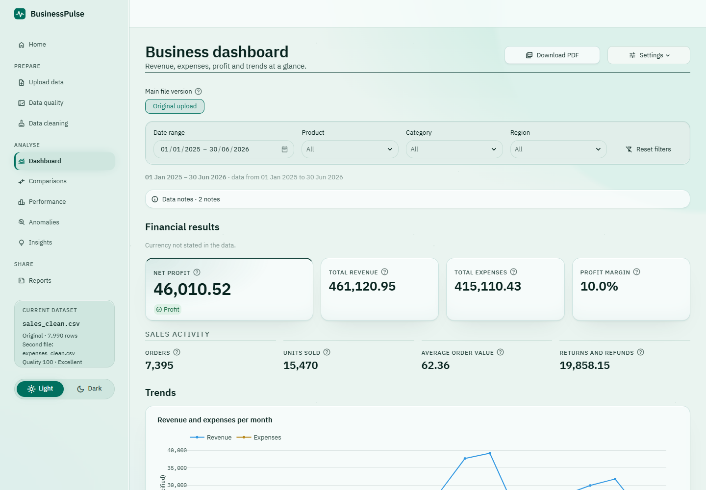
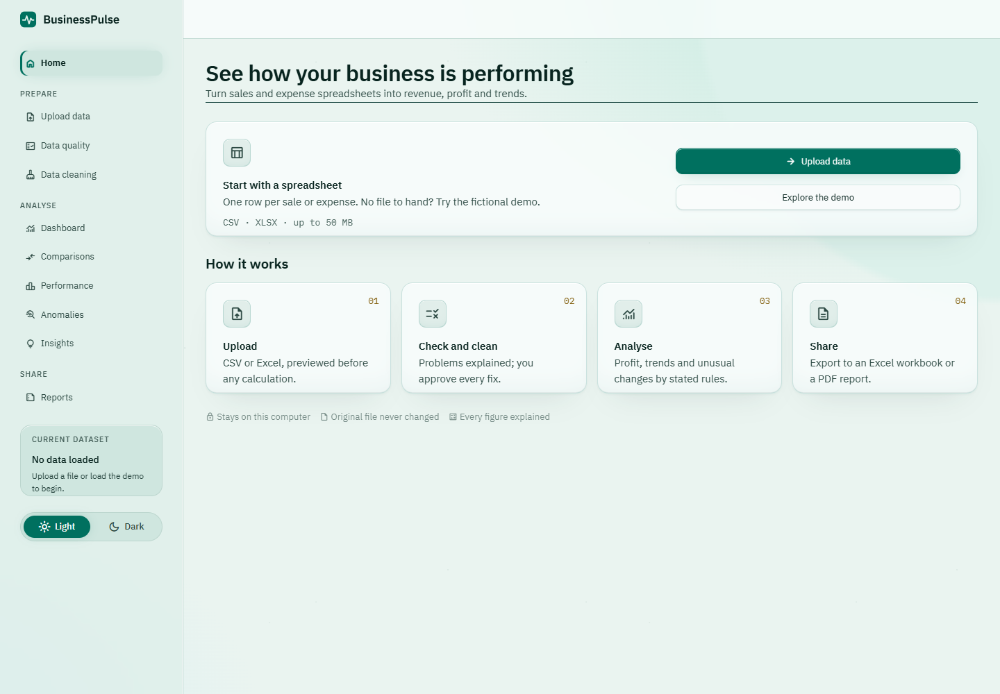
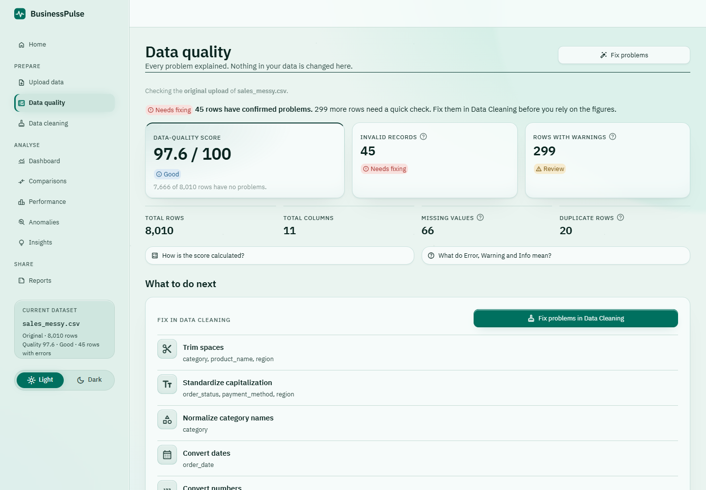
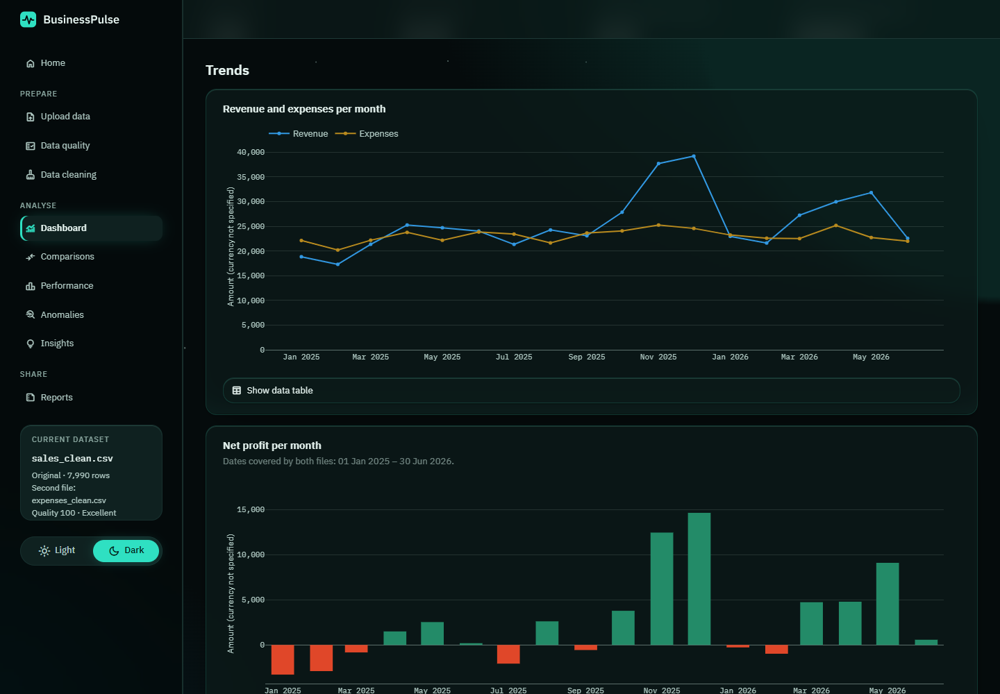
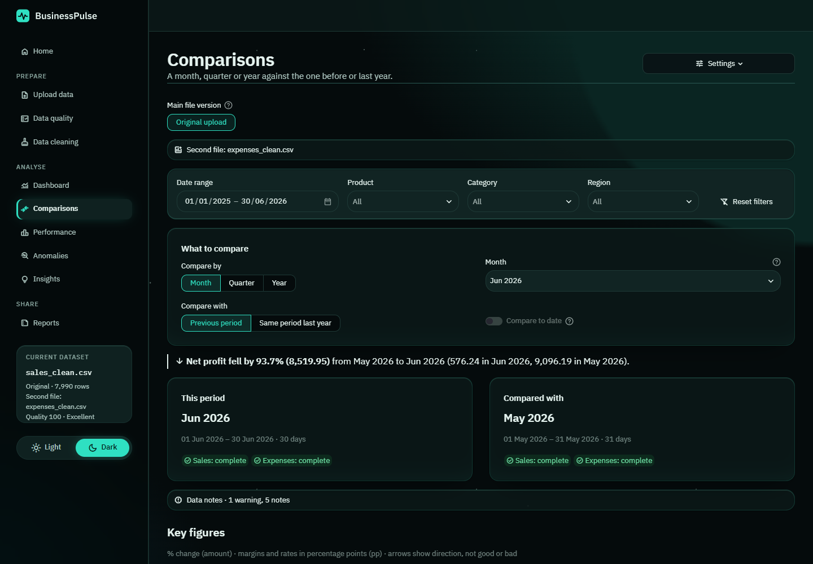
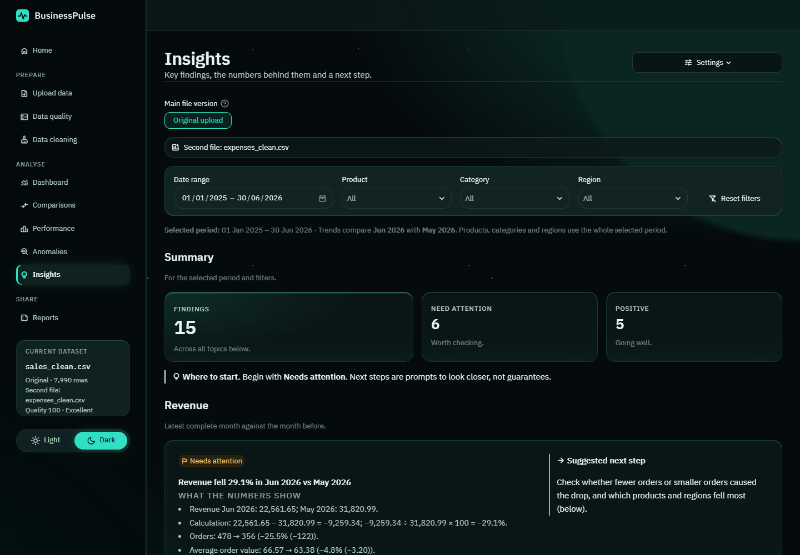
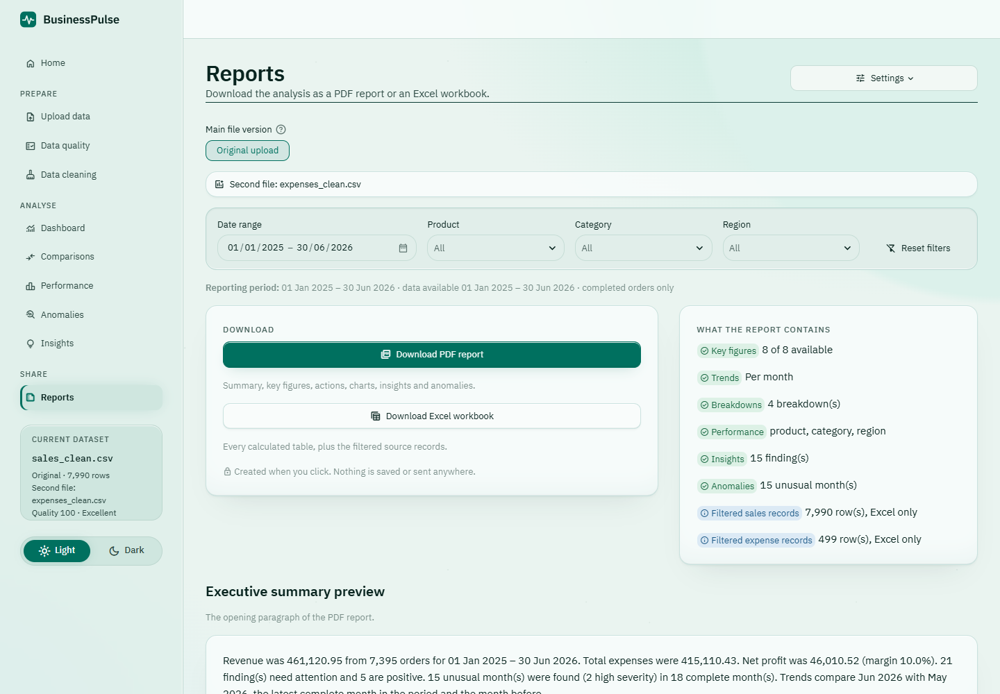
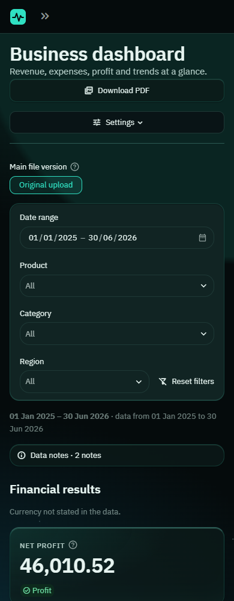

# BusinessPulse

**Turn sales and expense spreadsheets into clear, trustworthy business insight — privately, on your own computer.**

BusinessPulse is a local-first business analytics app for small businesses. You upload a CSV or Excel file, it explains any data problems, lets you fix them step by step, and then shows your revenue, expenses, profit and trends on interactive pages.

- **Runs locally.** No account, no cloud, no payment. Your data never leaves your computer.
- **Your original file is never changed.** Cleaning happens on a separate working copy.
- **Nothing is invented.** Every figure can be traced back to its formula and rows. If a number can't be calculated, the app tells you why instead of showing 0.
- **No AI services.** Insights come from fixed, transparent rules that you can read in [config/business_rules.py](config/business_rules.py).

### Screenshots

All screenshots use the fictional sample data. The app has a light and a dark theme (switch at the bottom of the sidebar).



| | |
|---|---|
|  |  |
| **Home**: four steps and one clear next action | **Data quality**: every problem found, scored and explained |
|  |  |
| **Dashboard charts** (dark theme) | **Comparisons**: month, quarter or year against the one before |
|  |  |
| **Insights**: findings with the numbers behind them | **Reports**: PDF and Excel downloads |



*The layout adapts to tablets and phones (shown: Dashboard at 390 px wide).*

---

## Contents

1. [Features](#1-features)
2. [Technology](#2-technology)
3. [Installation and launch (Windows)](#3-installation-and-launch-windows)
4. [Project structure](#4-project-structure)
5. [KPIs and formulas](#5-kpis-and-formulas)
6. [Data validation and cleaning](#6-data-validation-and-cleaning)
7. [Comparisons and Insights rules](#7-comparisons-and-insights-rules)
8. [Sample data](#8-sample-data)
9. [Testing](#9-testing)
10. [Known limitations](#10-known-limitations)

---

## 1. Features

### Completed

| Page | What it does |
|---|---|
| **Home** | What BusinessPulse does in four steps, with one clear next action. With no data loaded: **Upload data** or **Explore the demo** (loads the fictional sample sales and expenses and opens the Dashboard). With data loaded: the current file and its row count, **Open the dashboard**, **Check data quality**, or upload another file. |
| **Upload data** | Upload `.csv` or `.xlsx` files (up to 50 MB), choose the worksheet in a workbook with several sheets, preview the first 100 rows and see the detected type of each column. Sample datasets can be loaded from the same page. |
| **Data quality** | Recognises what each column holds (date, sales amount, product…) from its name, with manual correction. Finds missing values, duplicates, invalid numbers and dates, inconsistent spelling and more. Gives each problem a severity and gives the file a quality score. |
| **Data cleaning** | Detects problems automatically. **Apply all safe fixes** handles spaces, capitals, identical names, numbers and dates in one undoable step, with a before/after preview. Risky problems (duplicates, blanks, errors, ambiguous dates) are listed for your decision. Nine manual tools remain available. Every step is recorded in an audit log. Produces a separate *cleaned* version, so the original stays untouched. |
| **Dashboard** | The quick overview: KPI cards (revenue, expenses, profit, margin, orders, units, average order value, returns), revenue vs expenses over time, profit over time, and the revenue and expense mix. Filters for date, product, category and region. **Download PDF** saves the Dashboard (KPIs, trends, breakdowns) for the selected period and filters. A second (expense or sales) file can be added. |
| **Comparisons** | Month-, quarter- and year-level comparisons against the previous period or the same period last year. Key figures in three groups (financial, sales activity, returns), a bar chart of revenue, expenses and profit for both periods, period completeness, and a "compare to date" option. |
| **Performance** | The deeper analysis: the leading product, category and region, the sales trend for any metric, and for each product, category and region a chart, a full table and the top 5 / bottom 5 by any metric. |
| **Insights** | Plain-language findings with the supporting numbers and a suggested next step, e.g. *"Revenue grew 4.2% in March 2026 vs February 2026"*. |
| **Anomalies** | Months where revenue, expenses, profit, or a product's, category's or region's share of revenue moved far outside its usual range, with the figures, the reason and a severity (medium or high). |
| **Reports** | Download the analysis as a formatted **Excel workbook** or a branded **PDF report**, for exactly the data version, period, filters and counting settings chosen on the page. See [Reports](#reports-excel-and-pdf) below. |

On every analysis page you can choose to **count pending orders as revenue** and to **include rows with confirmed errors**. Both are off by default. Every KPI has a hover explanation showing its definition and the exact calculation.

### Planned (not yet built)

- A step-by-step guided demo tour (currently the demo only loads the sample data).
- Optional online hosting. This is only a later idea, and current pricing and payment-card requirements would be checked first.

---

## 2. Technology

All free and open source. Exact versions are in [requirements.txt](requirements.txt).

| Tool | Version | Used for |
|---|---|---|
| Python | 3.15.2 (tested) | Programming language |
| Streamlit | 1.67.0 | The web interface, run locally in your browser |
| pandas | 3.1.1 | Reading and calculating with tables |
| Plotly | 7.1.0 | Interactive charts |
| openpyxl | 3.1.5 | Reading Excel `.xlsx` files and writing the Excel report |
| ReportLab | 5.1.0 | Writing the PDF report, including its charts |
| pytest | 9.2.0 | Automated tests (development only) |

No database, external API, external font, icon or image is used.

---

## 3. Installation and launch (Windows)

These steps use **Windows PowerShell**. Run each command on its own.

**0. Get the code.** On GitHub, click **Code → Download ZIP** and unzip it, or clone the repository with Git. Then open PowerShell **inside the project folder** (the one containing `app.py`).

**1. Check Python is installed** (3.15 is the tested version):

```powershell
python --version
```

**2. Create a virtual environment.** This is a private folder (`.venv`) holding this project's libraries, so they don't affect anything else on your computer. You only do this once.

```powershell
python -m venv .venv
```

**3. Install the libraries** (once):

```powershell
.\.venv\Scripts\python.exe -m pip install -r requirements.txt
```

**4. Start the app:**

```powershell
.\.venv\Scripts\python.exe -m streamlit run app.py
```

Your browser opens BusinessPulse at `http://localhost:8501`. To stop the app, click the PowerShell window and press **Ctrl + C**.

> Calling `.\.venv\Scripts\python.exe` directly means you don't need to "activate" the environment. It also avoids PowerShell's script-permission warnings.
>
> **macOS / Linux:** the same steps work with `python3 -m venv .venv`, then `.venv/bin/python -m pip install -r requirements.txt` and `.venv/bin/python -m streamlit run app.py` (tested on Windows only).
>
> **Try it quickly:** on the Home page, click **Explore the demo** to load the fictional sample data.

---

## 4. Project structure

```
BusinessPulse/
├── app.py                  App entry point: logo, styles, navigation, sidebar dataset card
├── views/                  One file per screen (layout only, no calculations).
│                           Not called "pages/": Streamlit would treat that name specially
│                           and could open a screen without the app frame.
│   ├── home.py  upload.py  data_quality.py  data_cleaning.py
│   └── dashboard.py  comparisons.py  performance.py  insights.py  anomalies.py  reports.py
├── tools/                  All data processing (no Streamlit code; tested on its own)
│   ├── report_data.py        One snapshot of everything a report contains (reuses the page calculations)
│   ├── excel_report.py       Writes the Excel workbook (openpyxl)
│   ├── pdf_report.py         Writes the PDF report and its charts (ReportLab)
│   ├── file_loader.py        Reading CSV / Excel safely
│   ├── column_mapping.py     Recognising what each column means
│   ├── data_quality.py       Finding and scoring data problems
│   ├── data_cleaning.py      Preview → apply → undo cleaning steps, audit log
│   ├── business_metrics.py   KPIs, filters, time series, breakdowns
│   ├── period_comparison.py  Period completeness and period-vs-period changes
│   ├── performance.py        Product / category / region tables, top & bottom
│   ├── insights.py           Rule-based findings
│   ├── anomalies.py          Unusual-month detection (robust z-score)
│   ├── charts.py             Plotly charts
│   ├── sample_data.py        Serving the sample files
│   ├── generate_sample_data.py  Rebuilds the sample files (fixed seed)
│   └── browser_check.py      Developer tool: screenshots of the running app (headless Chrome/Edge)
├── config/                 Settings you can adjust
│   ├── settings.py           Upload limit, preview size
│   ├── quality_rules.py      Column synonyms and data-quality thresholds
│   ├── business_rules.py     Order statuses and insight thresholds
│   ├── design.py             Colours, fonts and spacing (design system)
│   └── session_keys.py       Names of stored app state
├── ui/                     Shared interface parts: components, styles.css, accessibility checks, state
├── assets/                 Logo and icon (SVG)
├── static/fonts/           Bundled open-licence fonts (IBM Plex, Source Serif 4) + SIL OFL licences
├── docs/screenshots/       Screenshots used in this README (fictional sample data)
├── data/sample/            Fictional sample datasets + their own README
├── data/uploads/           Reserved for user files (kept out of Git)
├── reports/                Reserved for generated reports (kept out of Git)
├── tests/                  Automated tests
├── .streamlit/config.toml  Streamlit theme and upload limit
└── requirements.txt        Exact library versions
```

---

## 5. KPIs and formulas

All KPIs are calculated in [tools/business_metrics.py](tools/business_metrics.py) for the selected dates and filters.

**Which sales count as revenue.** If the file has an order-status column, statuses are grouped using the lists in [config/business_rules.py](config/business_rules.py). Statuses are compared ignoring capitals and extra spaces.

| Status group | Examples | Counted as revenue? |
|---|---|---|
| Revenue | completed, paid, delivered, shipped | Yes |
| Pending | pending, processing, on hold | Only if you tick *Count pending orders as revenue* |
| Returned | returned, refunded, chargeback | No (reported separately) |
| Cancelled | cancelled, void, failed | No |
| Unrecognised | e.g. `TBD`, `???` | No (reported in a note) |

If there is no status column, every row counts. The page always states how many orders were left out and what they were worth.

| KPI | Formula | Notes |
|---|---|---|
| **Total revenue** | Sum of the sales amount over counted rows | With no amount column, amount = quantity × unit price. Negative amounts (refunds) reduce revenue. |
| **Orders** | Number of different order IDs among counted rows | Shown as **Transactions** (= counted rows) when there is no ID column. |
| **Units sold** | Sum of quantity over counted rows | |
| **Average order value** | Revenue ÷ orders | |
| **Returns and refunds** | Value of returned/refunded orders + negative amounts | Information only. Never part of revenue. |
| **Total expenses** | Sum of the expense amount in the expense file, in the selected dates | Product, category and region filters don't apply, because expenses aren't recorded per product. |
| **Cost of sales** | Sum of a cost column inside the sales file | Used instead of expenses when there is no separate expense file. |
| **Net profit** | Revenue − expenses, **only over the dates both files cover** | Hidden while filtering by product, category or region. Not calculated if the two files use different currencies. |
| **Gross profit** | Revenue − cost of sales (rows with a cost only) | When the sales file has its own cost column. |
| **Profit margin** | Profit ÷ revenue × 100 | Not shown if revenue is 0. |

Sales and expense files are **never merged row by row**. They are only combined as totals over shared dates, so nothing is counted twice.

**Charts.** The time grouping is chosen automatically: daily up to 45 days, weekly up to 180 days, monthly beyond that. You can also pick it yourself. Breakdown charts show the top 10 items; the rest are combined into "All others".

---

## 6. Data validation and cleaning

### Loading ([tools/file_loader.py](tools/file_loader.py))

- Accepts `.csv` and `.xlsx`, up to 50 MB. Older `.xls` files must be re-saved as `.xlsx`.
- For CSV files, the text encoding and separator (comma, semicolon, tab, `|`) are detected automatically.
- Values are kept exactly as written. Converting them happens later, as an explained step.
- Empty, damaged or unsupported files give a clear message instead of crashing. Duplicate or blank headings are renamed, and you are told about it.

### Column recognition ([tools/column_mapping.py](tools/column_mapping.py))

Column names are matched against synonyms in [config/quality_rules.py](config/quality_rules.py). For example, "Total Sales (USD)", "Revenue" and "sales_amount" all mean *sales amount*. A generic name such as "Amount" counts as an expense when other column names suggest an expense file. You can correct any match by hand. A role that isn't found is reported as "not found" and is never guessed.

### Quality checks ([tools/data_quality.py](tools/data_quality.py))

The checks only **read** the data. Each problem gets a severity:

- **Error:** confirmed problems that would make figures wrong. Examples: a blank required value (ID, date, amount, quantity, unit price), an impossible date, text in a number column, exact duplicates.
- **Warning:** things that are probably wrong but could be genuine. Examples: negative or zero amounts (they may be refunds), extreme values, inconsistent spelling or capitals, extra spaces, quantity × unit price ≠ total.
- **Info:** notes that don't affect the score.

The **Show** buttons above the problem table filter it by severity. If no problem matches the chosen levels, a short message says so instead of an empty table.

Other rules worth knowing:

- **Extreme values** are numbers outside Q1 − 10×IQR … Q3 + 10×IQR. IQR is the spread of the middle 50% of values. The check needs at least 20 numbers.
- **Future dates** are dates after today.
- **Ambiguous dates** such as `03/05/2025` are read day-first by default.

**Quality score** = 100 × (clean rows + 0.5 × rows with warnings only) ÷ all rows − 2 points per completely empty column (10 points at most). Rows with errors count as 0.

| Score | Grade |
|---|---|
| 98 or more | Excellent |
| 90 or more | Good |
| 75 or more | Fair |
| Below 75 | Poor |

**In the analysis,** rows with errors are left out of every figure by default, and the number left out is always shown. Rows with no usable date are also left out of time-based figures.

### Cleaning ([tools/data_cleaning.py](tools/data_cleaning.py))

Three versions are kept separately:

1. **Original:** never changed.
2. **Working copy:** where the steps you approve are applied.
3. **Cleaned data:** a snapshot you create when you are happy with the result.

**Recommended fixes (one click).** The Data cleaning page detects problems automatically and splits them into two groups:

- **Safe fixes**, applied together with **Apply all safe fixes**: trim extra spaces, use the most common existing spelling of a name (`north` → `North`), merge names that differ only in capitals, spaces or punctuation (`Home and Kitchen` → `Home & Kitchen`), and convert numbers and dates that can be read in only one way. A before/after preview lists every visible change first. All safe fixes are recorded as **one step**, so a single **Undo last step** reverses them; **Restore original** undoes everything.
- **Needs your decision**, never changed automatically: duplicate rows, missing values, rows with errors, ambiguous dates such as `03/05/2025`, look-alike names (`Electronis` / `Electronics`), mixed decimal conventions and text left in number columns. Each row opens the matching manual tool.

Safe fixes never remove rows, never fill blanks and never guess.

Each manual step shows a **preview** first: what changes, which rows, before/after examples and any risks. Nothing happens until you apply it, and every applied step can be **undone**.

The nine manual steps (under **All cleaning tools**) are:

1. Trim spaces
2. Standardise capitalisation (most common form, Title, UPPER or lower)
3. Normalise category names (e.g. `Electronis` → `Electronics`)
4. Convert dates (you choose day-first or month-first for ambiguous ones)
5. Convert numbers (handles `$24.99` and decimal commas)
6. Handle missing values (fill with a value, zero, mean, median or "Unknown", or exclude the rows)
7. Exclude duplicate rows
8. Exclude invalid records
9. Edit a single value

Rows are never deleted. Excluded rows stay in the original and are listed with the reason. The Dashboard, Comparisons, Performance and Insights pages can use either the original or the cleaned version. When cleaning creates a newer version, the analysis pages switch to it automatically.

**Data-quality status in one place.** The sidebar's *Current dataset* card shows the quality score of the data the analysis pages use (for example `Quality 98.7 · Excellent · 45 rows with errors`), and it updates after every cleaning step. The analysis pages show their warnings as one collapsed *Data notes* line that opens with a click and links to the Data quality page.

Columns that already hold real numbers or dates but are stored as mixed values (common in Excel files) can now be converted: earlier, *Convert numbers* reported "nothing would change" for them and Apply stayed disabled.

---

## 7. Comparisons and Insights rules

### Comparisons ([tools/period_comparison.py](tools/period_comparison.py))

Each period's figures come from the same calculation as the Dashboard, so the numbers always match.

**A period is complete only when all of these are true:**

- the data covers every day of it;
- it has already ended;
- it has no unusually long run of days without records.

A run counts as unusually long when it is at least 14 days **and** longer than 3 × the file's usual quiet stretch. The usual quiet stretch is the 90th percentile of the empty days between records.

A period with no records at all is never treated as complete, because missing data can't be told apart from "no sales". Incomplete periods still show their figures, clearly labelled, but **no change is calculated** for them. The *Compare to date* option compares the same number of days instead (e.g. 1–17 Nov vs 1–17 Oct).

| Measure | Formula |
|---|---|
| Change | current − comparison |
| % change | (current − comparison) ÷ comparison × 100. Only shown when the comparison value is above 0. |
| Margin change | current margin − comparison margin, in percentage points (pp) |
| Revenue per day | revenue ÷ days of the period covered by the data |
| Return rate | returned orders ÷ (completed + returned orders) × 100 |
| Cancellation rate | cancelled orders ÷ orders with a recognised status × 100 |
| Growth gap | expense % change − revenue % change, in pp |

Return and cancellation rates are shown only when all of these are true:

- the file has a status column;
- the file uses at least one returned (or cancelled) status;
- at most 5% of the period's orders have an unrecognised status.

### Anomalies ([tools/anomalies.py](tools/anomalies.py))

Each **complete** month is compared with up to 12 complete months before it (at least 6 are needed). The typical month is their median and the usual variation their median absolute deviation (MAD). **Robust z-score = 0.6745 × (month − median) ÷ MAD.** A month is flagged when |z| ≥ 3.5 (medium) or ≥ 5 (high) *and* it is at least 15% away from the median. Revenue, expenses and profit use their monthly totals. Products, categories and regions with at least 3% of revenue use their **share of each month's revenue**, so a season that lifts every item isn't flagged item by item, and the share must move by at least 1 percentage point. Partial months are never checked or used as a baseline. When there are too few complete months, the page says so instead of guessing. Thresholds are in [config/business_rules.py](config/business_rules.py).

### Insights ([tools/insights.py](tools/insights.py))

Insights reuse the figures above; nothing is calculated twice. Revenue, profit and expense findings compare the **latest complete month** in the selected dates with the month before. Product, category and region findings use the whole selected period. The thresholds are in [config/business_rules.py](config/business_rules.py).

| Finding | Rule |
|---|---|
| Revenue grew / fell / was steady | % change vs previous month. Under ±2% counts as "steady". The finding also includes the order-count and average-order-value changes. |
| Revenue trend | Added when revenue rose (or fell) **3 or more months in a row** |
| Loss | Profit below 0 in a complete month |
| Profit rose / fell / unchanged | Profit change vs previous month, with the margin change |
| Expenses vs revenue | Flagged when the growth gap is +2 pp or more (needs attention) or −2 pp or less (positive) |
| Biggest expense increase | The expense category whose amount rose most |
| Top / weakest product, category, region | Highest and lowest revenue (needs at least 2 items) |
| Concentration risk | One item has **40% or more** of revenue (needs at least 3 items) |
| Biggest riser / faller | The item whose revenue changed most between the two compared months |

If a finding can't be made, the page explains why (for example, *"Needs revenue for two complete months"*).

### Reports (Excel and PDF)

Open **Reports** under *Analysis*. Choose the data version, second file, dates, filters and counting options as on the other Analysis pages, then click **Download PDF report** or **Download Excel workbook**. The files are created in memory when you click; nothing is saved on the computer or sent anywhere.

**Same figures as the app.** [tools/report_data.py](tools/report_data.py) only calls the functions the Dashboard, Performance, Insights and Anomalies pages use, with the same inputs. The exports copy those results; they calculate nothing themselves.

| Excel sheet | Contents |
|---|---|
| Summary | Report details (data, version, period, filters, settings, currency, generation time), a clickable contents list of every sheet, executive summary, the six priority findings, and every KPI with its definition and calculation |
| Trend | Revenue, expenses, profit, orders, units and average order value per period, with native Excel charts |
| Breakdowns | Revenue by category, product and region; expenses by category |
| Performance | Top and bottom 5, and every product, category and region |
| Insights | Every finding with its evidence and suggested next step, plus why a topic had no finding |
| Anomalies | Every unusual month with its severity, value, typical value, reason and evidence, plus what was checked and why an area was not checked |
| Data notes | Every warning and note that affects the figures |
| Filtered sales / expense records | **Source rows, not a calculated summary**: only the rows that match the report's version, dates, filters and error-row choice, with their original columns. Sales rows also show whether each one is counted in revenue and, if not, why (for example *pending*, *returned*). |

Figures are stored as real numbers and dates with display formats (currency, thousands separators, `DD MMM YYYY`, `MMM YYYY` for monthly periods), so they can still be summed, filtered and charted in Excel. **Percentages are stored as fractions** (a 12.5% share is the value `0.125`, formatted `0.0%`), so Excel calculations with them are correct. In the source-record sheets, a column the upload kept as text is written as numbers or dates only when every value is unambiguous (a plain number like `38.50`, an ISO date like `2025-01-31`); IDs with leading zeros, `1,000`, `$10` or `31/01/2025` stay exactly as uploaded.

**Layout:** serif sheet titles over a thin ink rule, ivory table headers, no gridlines on the report sheets, frozen header rows and filters on the long tables, losses shown in the loss colour (with their minus sign), and status always written as a word. Every sheet prints on A4 fitted to the page width, with repeated table headers and page numbers. The workbook uses Calibri and Cambria, which every Excel installation has.

**Formula-injection protection:** every text value (file names, product names, notes…) is stored as plain text; text starting with `=`, `+`, `-`, `@`, a tab or a line break gets Excel's quote prefix, so it is never run as a formula. The workbook contains no formulas.

The **PDF** is an A4 report in the app's *Mineral & Ink* style (white paper, ink text and rules, Source Serif headings, IBM Plex Sans text, IBM Plex Mono for table figures and axis numbers; every status shown as an icon plus a label): serif title with the reporting period and generation date, report details with the active filters, an executive summary with the key figures, **priority actions** (high-severity unfavourable anomalies first, then findings that need attention, then positive ones, each with a next step), trend and profit charts, revenue mix, top and bottom performers, insights, anomalies, and the methodology and data notes.

**Currencies are never combined.** If the sales and expense files state different currencies, each figure keeps its own file's currency, profit is not calculated, revenue and expenses get separate charts, and expense/profit findings are left out of the report, with the reason. If one file contains different currency symbols, both exports show a warning that its totals may combine currencies.

---

## 8. Sample data

All sample data is **fictional**: an imaginary online shop, with customers shown only as IDs. Full details are in [data/sample/README.md](data/sample/README.md).

| File | Rows | Use it to… |
|---|---|---|
| `sales_clean.csv` | 7,990 | Explore the Dashboard, Comparisons, Performance and Insights |
| `expenses_clean.csv` | 499 | Add expenses to see profit and margin |
| `sales_messy.csv` | 8,010 | Try Data quality and Data cleaning: it has 339 deliberate problems |
| `sales_messy_issue_log.csv` | 339 | Answer key listing every problem in the messy file |

The data covers 1 January 2025 to 30 June 2026.

**How to use it:**

- **Quickest:** click **Explore the demo** on the Home page. It loads the sample sales and expenses and opens the Dashboard.
- **Or:** on **Upload data**, pick a dataset under *Try sample data*. The last option is an Excel workbook with three sheets, built in memory, for trying worksheet selection.
- **To see profit:** on the Dashboard, open *Add a separate expense file* and click *Use the sample expense file*.

The files are rebuilt with a fixed random seed by `tools/generate_sample_data.py`. Their SHA-256 fingerprints are stored in `data/sample/checksums.json`, and the tests fail if a sample file changes.

---

## 9. Testing

The project has **719 automated tests** in [tests/](tests/). They cover:

- loading files and recognising columns;
- the quality checks and cleaning steps;
- every KPI and comparison formula;
- the insight rules;
- the sample-data checksums;
- the design system (colour contrast, colour-blind safety, no hard-coded page colours);
- the Excel and PDF reports (same figures as the app, filtered records, currencies, formula-injection protection, missing data);
- the Upload, Data quality, Data cleaning, Dashboard, Comparisons, Performance, Insights, Anomalies and Reports pages running without errors.

Run them from the project folder:

```powershell
.\.venv\Scripts\python.exe -m pytest tests
```

The last full run: **719 passed** in about 5 minutes. For a shorter summary, add `-q` to the end of the command.

---

## 10. Known limitations

- **PDF text is limited to Western European characters** (Windows-1252), so characters outside those alphabets (for example Chinese or Arabic product names) print as `?` in the PDF. The Excel export keeps them exactly.
- **Very large exports.** An Excel sheet holds at most 1,048,576 rows; the records sheet says so if rows are left out (totals still include them). A file of ~8,000 rows takes about 5 seconds to create.
- **Mixed currencies in the app pages.** The Reports page leaves out expense and profit findings when the two files use different currencies; the Insights and Anomalies pages still show them with one currency label.
- **Two files at most.** You can analyse one main file plus one second file (sales + expenses). The second file is used as uploaded: it doesn't go through the cleaning steps, although rows with confirmed errors are still left out.
- **Expenses can't be split** by product, category or region. Net profit is therefore hidden while those filters are on.
- **Supported formats:** `.csv` and `.xlsx` only (no `.xls`, Google Sheets or database connections). Up to 50 MB, one table per sheet.
- **Column recognition relies on names.** Unusual headings may need matching by hand on the Data quality page.
- **One currency.** Currencies are not converted. Profit isn't calculated if the two files state different currencies. If a file doesn't state its currency, the app assumes both files use the same one.
- **Returns use the order date.** Returns are counted in the month the order was placed, because the data has no return date.
- **No saved sessions.** Data lives only in the open browser session. Closing or refreshing the app clears it.
- **Insights are rule-based**, not forecasts. They describe what changed, not why.
- **Anomalies compare with recent months, not with the same month last year**, so regular seasonal peaks (e.g. November–December) can be flagged for revenue, expenses and profit.
- **Local only.** The app is designed for one person on one computer. There is no login or multi-user support.
